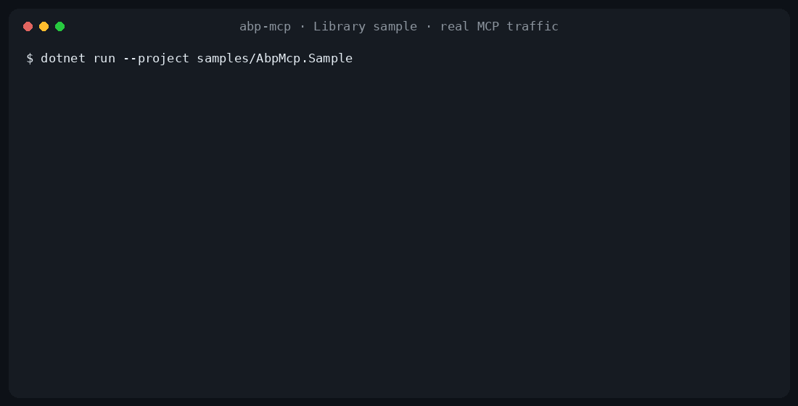
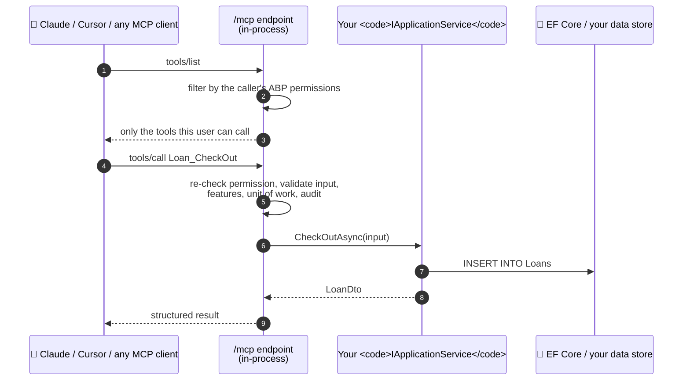

# abp-mcp

[](https://www.nuget.org/packages/AbpMcp)
[](https://www.nuget.org/packages/AbpMcp)
[](https://github.com/tekthar/abp-mcp/actions/workflows/ci.yml)
[](https://github.com/tekthar/abp-mcp/blob/main/LICENSE)

**Your ABP app, ready for AI agents, with the permissions you already have.**

abp-mcp turns your ABP Framework application services into tools that Claude, Cursor and any other
[Model Context Protocol](https://modelcontextprotocol.io) (MCP) client can call. Add one attribute, and an agent can
use your app the way a signed-in user does: same permissions, same tenant, same validation, same business rules.

```csharp
[McpTool]                                              // ← the whole integration
public class LoanAppService : ApplicationService, ILoanAppService
{
    /// <summary>Check out an edition to a member. Refused with LIBRARY:MEMBER_SUSPENDED
    /// if the member is suspended.</summary>
    [Authorize(LibraryPermissions.Loans.CheckOut)]
    public async Task<LoanDto> CheckOutAsync(CheckOutDto input) { /* your code */ }
}
```

An agent connected to `/mcp` now sees a `Loan_CheckOut` tool, described by your doc comment, with a JSON schema built
from `CheckOutDto`, but only if its token has `Loans.CheckOut`. Calling it runs your method with the same validation,
unit of work, feature checks and audit logging as your REST endpoint.



<sub>Real MCP traffic from the bundled Library sample, rendered from a recorded session.</sub>

## Why you'll like it

- **Zero config**: depend on `AbpMcpModule`, map the endpoint, tag a service. abp-mcp finds your `[McpTool]`
  assemblies in the ABP module graph by itself.
- **Same rules as your REST API**: `[Authorize]` (permissions, roles, schemes), validation, unit of work,
  `[RequiresFeature]`, multi-tenancy and audit logging all apply to every tool call.
- **Agents only see what they may call**: `tools/list` is filtered by the caller's permissions, and every call is
  checked again.
- **Opt-in, never "expose everything"**: a service is invisible until you mark it `[McpTool]`, and `[McpIgnore]`
  hides single methods.
- **Descriptions agents understand**: your XML doc comments become tool and parameter descriptions. Schemas come from
  your real DTOs, with enums, nested objects and DataAnnotations constraints.
- **Errors agents can act on**: your business exception codes reach the agent as `[LIBRARY:MEMBER_SUSPENDED] …`, and
  invalid input names the field. Never a stack trace.
- **Built for production**: turn a tool off on every instance without a redeploy, protect local servers from
  malicious web pages, and push `tools/list_changed` to connected agents.
- **Explains itself**: `/mcp/_explain` tells you why a method is, or isn't, a tool.

## Install

In a layered ABP solution, the attributes and the server go in different projects:

```bash
# *.Application: the [McpTool] and [McpIgnore] attributes only, with no dependencies
dotnet add src/MyApp.Application package AbpMcp.Abstractions

# *.HttpApi.Host (or your single-project app): the MCP server
dotnet add src/MyApp.HttpApi.Host package AbpMcp
```

`AbpMcp.Abstractions` keeps ASP.NET Core, MVC and the MCP SDK out of your Application layer. `AbpMcp` depends on it,
so a single-project app only needs `AbpMcp`. Code built against an earlier `AbpMcp`, with the attributes in
`AbpMcp.dll`, keeps working: `AbpMcp` forwards them.

Requires .NET 10 and ABP Framework 10.1 or later. (`0.3.0-alpha` is the last release for .NET 9 / ABP 9.2.)

## Crash course

### 1. Mount the endpoint

Add `AbpMcpModule` to your host module and map `/mcp`:

```csharp
[DependsOn(typeof(AbpMcpModule) /*, your other modules */)]
public class MyAppHttpApiHostModule : AbpModule
{
    public override void OnApplicationInitialization(ApplicationInitializationContext context)
    {
        var app = context.GetApplicationBuilder();
        app.UseRouting();
        app.UseConfiguredEndpoints(endpoints => endpoints.MapAbpMcp());
    }
}
```

By default `/mcp` requires an authenticated caller, like the rest of your API.

### 2. Tag your services

```csharp
[McpTool]
public class ProductAppService : ApplicationService, IProductAppService
{
    [Authorize("Products.Create")]
    public Task<ProductDto> CreateAsync(CreateProductDto input) => /* ... */;
}
```

Each public method becomes a tool named `Service_Method`, so `ProductAppService.CreateAsync` is `Product_Create`.
`[McpTool]` on a single method exposes just that method, and `[McpIgnore]` hides one (also when declared on the
interface).

No assembly registration is needed: abp-mcp scans the module graph for assemblies that reference `AbpMcp` or
`AbpMcp.Abstractions` and declare `[McpTool]` services. To choose assemblies yourself, turn discovery off and register them:

```csharp
Configure<AbpMcpOptions>(opts =>
{
    opts.AutoDiscoverAssemblies = false;
    opts.ExposedAssemblies.Create(typeof(MyAppApplicationModule).Assembly);
});
```

An app service ABP serves through a hand-written controller (`[RemoteService(IsEnabled = false)]` plus a controller
in `*.HttpApi`, typically for file uploads or custom routes) cannot be a tool: ABP's api-definition describes the
controller, not the service. `/mcp/_explain` lists such a service and says why. Wrap its JSON-friendly operations in a
thin, remoted `[McpTool]` app service instead; see
[hand-written controllers](https://github.com/tekthar/abp-mcp/blob/main/docs/hand-written-controllers.md).

### 3. Connect an agent

Any MCP client that speaks streamable HTTP can connect. With [Claude Code](https://claude.com/claude-code):

```bash
claude mcp add --transport http my-app https://your-host/mcp --header "Authorization: Bearer $TOKEN"
```

Agents call your tools with the same bearer tokens your ABP identity server issues to every other client.

**Signing in as yourself, without pasting tokens.** The [abp-mcp bridge](https://github.com/tekthar/abp-mcp/tree/main/bridge)
runs on each user's machine: it signs them in through your existing OpenIddict clients (browser sign-in, or a password
where needed), keeps the token fresh, reaches intranet and VPN-only hosts, and can limit an environment to read-only
tools. It comes as an npm package for Claude Code and a one-click extension for Claude Desktop:

```bash
npx -y abp-mcp profiles add staging --url https://staging-api.example.com/mcp --auth browser --client-id MyApp_Mcp
npx -y abp-mcp login staging
npx -y abp-mcp install staging --claude-code
```

### 4. Check what's exposed

Two diagnostic endpoints answer the "why isn't my tool showing up?" question without a debugger:

```bash
curl https://your-host/mcp/_discover   # the tools the caller can see, with schemas and required permissions
curl 'https://your-host/mcp/_explain?service=Loan'
```

```json
{
  "service": "AbpMcp.Sample.Library.LoanAppService",
  "method": "CheckOutAsync",
  "included": true,
  "reason": "Included: [McpTool] on class LoanAppService."
}
```

### 5. Write descriptions agents understand

Agents choose tools by their descriptions. abp-mcp uses your XML doc comments: the `<summary>` describes the tool and
each `<param>` describes its argument. When a method has no docs, the description falls back to a mechanical
`Invoke LoanAppService.CheckOutAsync.`, so document the methods agents will use, especially anything destructive and
the errors it can return. To override a description or name without touching the docs:

```csharp
[McpTool(Description = "Refund an order in full. Irreversible.", Name = "Billing_Refund")]
public Task RefundAsync(Guid orderId) => /* ... */;
```

## What the agent sees

This is the bundled sample, unedited. `tools/list` advertises your doc comment and a schema built from the DTO:

```json
{
  "name": "Loan_CheckOut",
  "description": "Check out an edition to a member for a number of days (default 14, at most 90). Refused with LIBRARY:MEMBER_SUSPENDED if the member is suspended, LIBRARY:NO_COPIES_AVAILABLE if every copy is on loan, or LIBRARY:MEMBER_NOT_FOUND / LIBRARY:EDITION_NOT_FOUND for an unknown id.",
  "inputSchema": {
    "type": "object",
    "properties": {
      "input": {
        "type": "object",
        "properties": {
          "memberId": { "type": "string", "format": "uuid" },
          "editionId": { "type": "string", "format": "uuid" },
          "durationDays": { "type": "integer" }
        },
        "description": "The member, the edition, and optionally the loan length in days."
      }
    },
    "required": ["input"]
  }
}
```

When a business rule says no, the agent gets your code and message, and can explain it or fix the cause:

```text
→ tools/call Loan_CheckOut { "input": { "memberId": "1111…", "editionId": "6050…" } }
← isError: true
  [LIBRARY:MEMBER_SUSPENDED] Member 'Demo Member' is suspended (Unpaid late fees). Reinstate before checking out.
```

When it succeeds, the result is your DTO, as structured content that matches the advertised output schema:

```json
{
  "titleName": "Foundation",
  "format": "Paperback",
  "memberName": "Demo Member",
  "dueAt": "2026-11-14T21:19:46.3880113Z",
  "status": "Active",
  "isOverdue": false
}
```

A caller without the permission never sees the tool, and gets `[FORBIDDEN] Missing permission: …` if it calls it
anyway. Every error code is a constant in `AbpMcpErrorCodes`.

## Try the sample (60 seconds, zero setup)

The repo ships a runnable ABP host with a small library domain (titles, editions, members, loans), seeded with
classic books. It has 16 tools, and anonymous access is turned on so you can try it without a token.

```bash
dotnet run --project samples/AbpMcp.Sample
```

```bash
claude mcp add --transport http library http://localhost:5000/mcp
```

Then ask Claude to find *Foundation* and check it out for the demo member. Or explore it from a terminal:

```bash
curl http://localhost:5000/mcp/_discover | jq '.tools[] | {name, description}'
```

For Claude Desktop, add this to `claude_desktop_config.json`
(`%APPDATA%\Claude\claude_desktop_config.json` on Windows, `~/Library/Application Support/Claude/claude_desktop_config.json` on macOS)
and restart it:

```jsonc
{
  "mcpServers": {
    "abp-mcp-sample": {
      "type": "streamable-http",
      "url": "http://localhost:5000/mcp"
    }
  }
}
```

## How it works

abp-mcp runs inside your ABP host. It reads the same API description ABP uses for its own client proxies, keeps the
`[McpTool]` services, and serves them through the official [MCP C# SDK](https://github.com/modelcontextprotocol/csharp-sdk):



### Compared with a generic OpenAPI → MCP bridge

| | abp-mcp | A generic OpenAPI → MCP bridge (typical) |
|---|---|---|
| Runs | Inside your ABP host, one NuGet package | As a separate process in front of your API |
| What becomes a tool | Only what you mark `[McpTool]` | Every operation in the spec, unless you filter |
| `tools/list` per user | Filtered by the caller's ABP permissions | The same list for everyone |
| Descriptions | Your XML doc comments, or `[McpTool(Description)]` | OpenAPI summaries, if there are any |
| Errors | Your business codes: `[LIBRARY:MEMBER_SUSPENDED] …` | An HTTP status and a response body |
| "Why isn't this a tool?" | `/mcp/_explain` | – |
| Turn one tool off everywhere | An ABP setting, no redeploy | Reconfigure or redeploy the bridge |

## Running in production

### Authentication and tenancy

`/mcp` sits on your normal request pipeline, so ABP's authentication and `ICurrentTenant` resolution work unchanged. A
token issued for tenant `T` calls into tenant `T`'s data, and header, cookie or route tenant resolvers work as for any
ABP endpoint. Cross-tenant impersonation is deliberately not supported.

### Browser-based clients

Desktop agents and CLIs send no `Origin` header and connect as they are. A request that carries one, such as the MCP
Inspector's web UI, is refused with `403` unless its origin is listed, as the MCP transport spec requires. This stops a
web page from driving your local or intranet MCP server through the user's browser:

```csharp
Configure<AbpMcpOptions>(opts => opts.AllowedOrigins.Add("http://localhost:6274")); // MCP Inspector
```

### Turning a tool off (kill switch)

To pull a misbehaving tool without a redeploy, disable it by name. It disappears from `tools/list`, is refused on
`tools/call` with `DISABLED`, and is flagged `"disabled": true` in `/mcp/_discover`. To make connected agents re-read
the tool list right away, call `IAbpMcpToolListChangedNotifier.NotifyToolListChangedAsync()`.

**On every instance**: set the global ABP setting `AbpMcp.DisabledTools` to a comma-separated list of tool names.
With [ABP Setting Management](https://abp.io/docs/latest/modules/setting-management) and the shared distributed cache
(e.g. Redis) a multi-instance deployment already uses, every instance picks it up within
`AbpMcpOptions.DisabledToolsSettingCacheDuration` (10 seconds by default):

```csharp
await settingManager.SetGlobalAsync(AbpMcpSettingNames.DisabledTools, "Loan_CheckOut,Member_Suspend");
```

Without Setting Management, put it in configuration:
`{ "Settings": { "AbpMcp.DisabledTools": "Loan_CheckOut,Member_Suspend" } }`. Tenant and user values are ignored.

**In this process only**: add names to `AbpMcpOptions.DisabledTools`. A tool listed in either place is disabled.

## Everything else

- **Dynamic tools and enrichment**: implement `IAbpMcpAddin` to add tools that no single service backs, or to enrich
  the generated ones. Change the tool set at runtime and notify connected agents with
  `IAbpMcpToolListChangedNotifier`. See [dynamic add-ins](https://github.com/tekthar/abp-mcp/blob/main/docs/dynamic-addins.md).
- **Naming**: `AbpMcpOptions.ToolNamePrefix`, or replace `ToolNameNormalizer` entirely.
- **Output schemas**: on by default (`IncludeOutputSchema`); list results are advertised and returned as
  `{ "result": [...] }`, as MCP requires an object.
- **Without an ABP module**: `builder.Services.AddAbpMcp(...)` and `app.MapAbpMcp()` work too.

## How do we know it works?

Agents act on behalf of real users, so a gap between the MCP path and your REST API would be a security hole. More than
170 automated tests run on every build, in three layers:

- **End to end, with the official MCP SDK client**: the bundled sample is booted in memory and driven over streamable
  HTTP. Tests cover the `tools/list` shape, structured results, error codes, `Origin` rules, session lifetime and
  `tools/list_changed` delivery.
- **Same rules as REST, one concern at a time**: integration tests cover `[Authorize]` (permissions, roles, schemes),
  ABP validation, unit-of-work rollback, `[RequiresFeature]` and `[RequiresGlobalFeature]`, and audit logging. These
  tests run for both virtual and non-virtual methods, because ABP's interceptors only cover virtual ones.
- **List and call are both gated**: `tools/list` hides what the caller can't use and `tools/call` checks again, and
  both paths are tested.

Every bug fix ships with a test that would have caught it, and CodeQL scans every pull request.

## Documentation

| Guide | What it covers |
|---|---|
| [Dynamic add-ins](https://github.com/tekthar/abp-mcp/blob/main/docs/dynamic-addins.md) | `IAbpMcpAddin`, dynamic tools, enriching tools, changing the tool set at runtime |
| [Hand-written controllers](https://github.com/tekthar/abp-mcp/blob/main/docs/hand-written-controllers.md) | Services served by a hand-written controller (`[RemoteService(IsEnabled = false)]`): why they are not tools, and the wrapper pattern |
| [The abp-mcp bridge](https://github.com/tekthar/abp-mcp/blob/main/docs/bridge.md) | Connecting Claude Code and Claude Desktop as the signed-in user: the OpenIddict client, token lifetimes, retries |
| [Design](https://github.com/tekthar/abp-mcp/blob/main/DESIGN.md) | Premises, the approaches considered, and what is deliberately out of scope |
| [Changelog](https://github.com/tekthar/abp-mcp/blob/main/CHANGELOG.md) | What each release changed |

The API reference ships as XML documentation, so your editor shows it as you type.

## Status and roadmap

This is **0.4.1**. It runs in production, but the API may still change before 1.0: minor versions may include breaking
changes, and the [changelog](https://github.com/tekthar/abp-mcp/blob/main/CHANGELOG.md) describes them. Coming next:

- choosing tools with type and method predicates ([#11](https://github.com/tekthar/abp-mcp/issues/11)) and
  include/exclude filters ([#12](https://github.com/tekthar/abp-mcp/issues/12))
- a Roslyn analyzer that flags `[McpTool]` on a non-application service ([#14](https://github.com/tekthar/abp-mcp/issues/14))
- an eShopOnAbp integration sample ([#17](https://github.com/tekthar/abp-mcp/issues/17))

## Have a question? Want to help?

Questions, ideas and bug reports are welcome as [issues](https://github.com/tekthar/abp-mcp/issues). To contribute code
or docs, read the [contributing guide](https://github.com/tekthar/abp-mcp/blob/main/CONTRIBUTING.md) first; it has the
design rules every change follows. Please report security problems through
[private reporting](https://github.com/tekthar/abp-mcp/blob/main/SECURITY.md), not in public issues.

```
src/AbpMcp/                      the library (package AbpMcp; net10.0)
samples/AbpMcp.Sample/           the Library sample host (16 tools, seeded data)
test/AbpMcp.Tests/               unit tests
test/AbpMcp.IntegrationTests/    integration tests, and end-to-end tests with the MCP SDK client (EndToEnd/)
docs/                            guides and README assets
```

To run the tests:

```bash
dotnet test
```

## Credits and licence

MIT licence.

abp-mcp is built on [ABP Framework](https://abp.io) and the official
[Model Context Protocol C# SDK](https://github.com/modelcontextprotocol/csharp-sdk). It is maintained by
[Tekthar](https://github.com/tekthar).

**Sister project:** [CASL .NET](https://github.com/tekthar/casl-net), permissions you can read out loud, for .NET.
